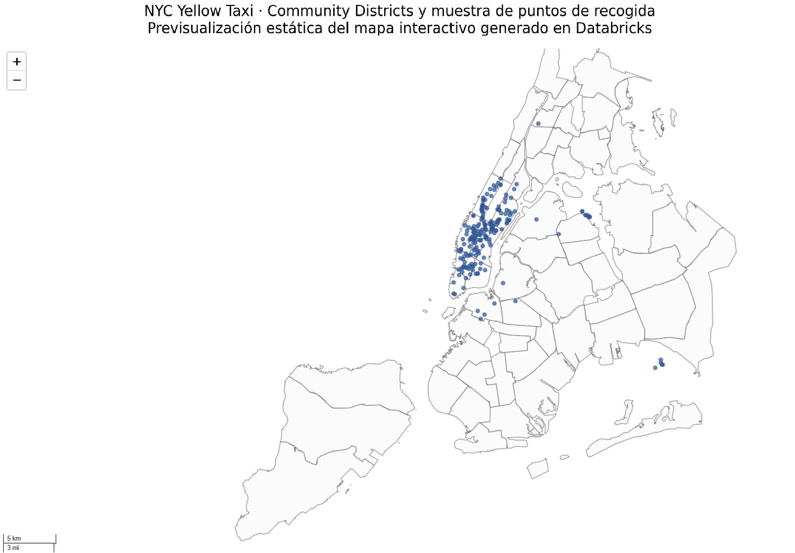
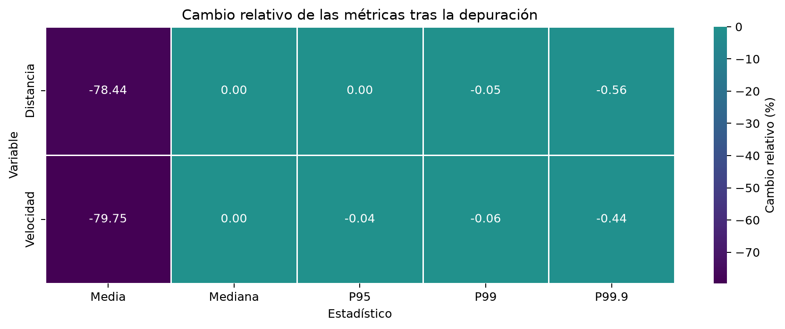
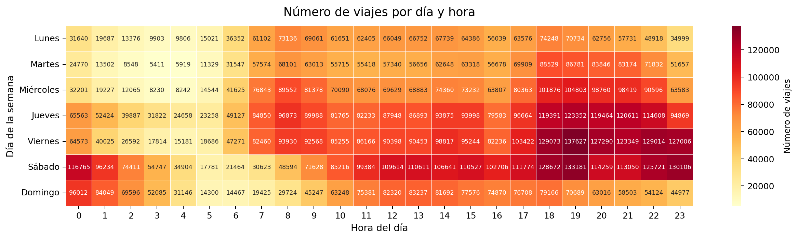
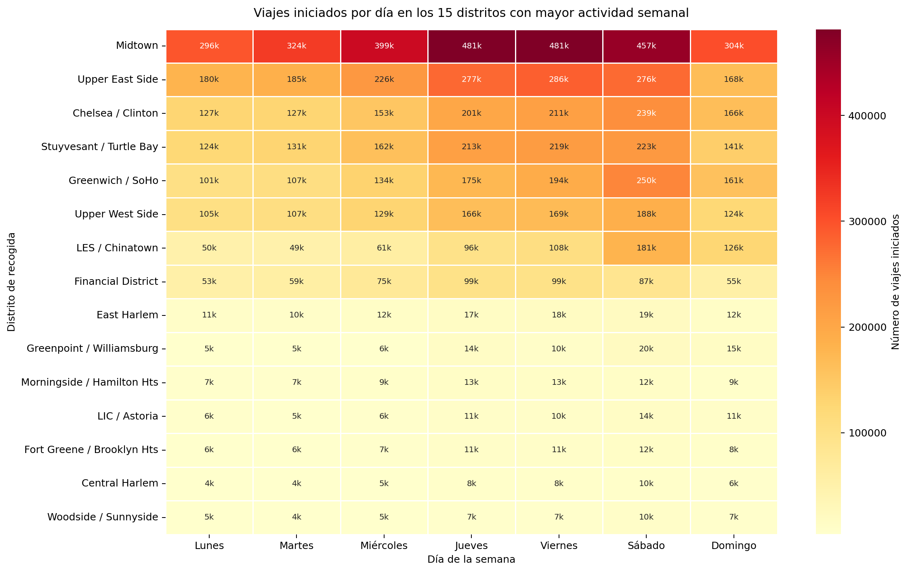
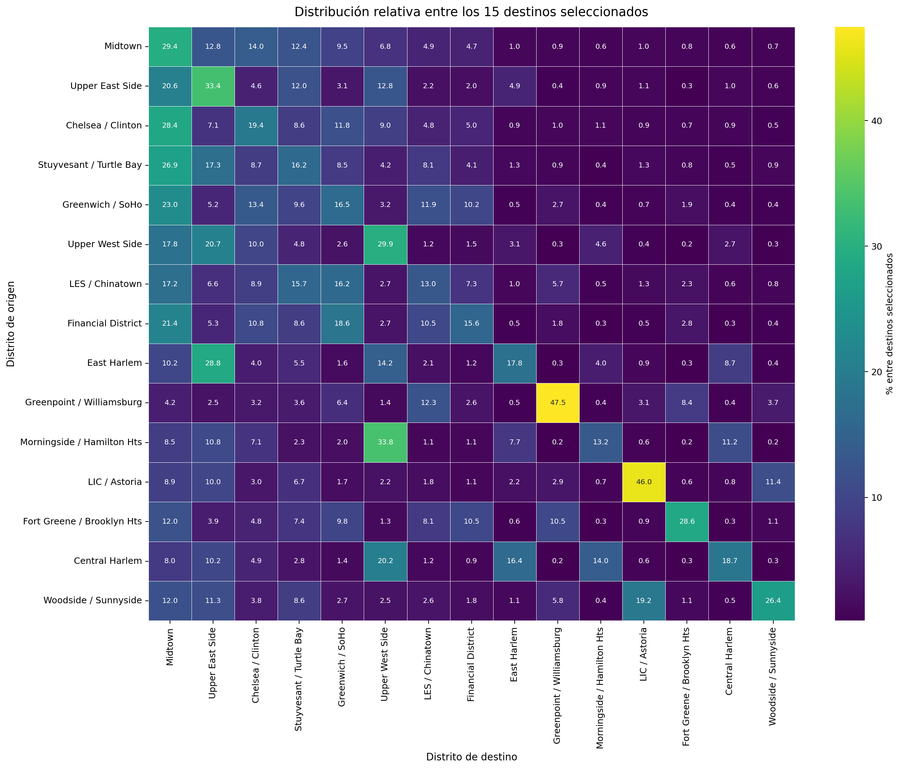

# NYC Yellow Taxi · Big Data con Apache Spark y Databricks

Proyecto de **Big Data, procesamiento distribuido y análisis geoespacial** sobre aproximadamente **11,5 millones de viajes de taxi amarillo de Nueva York** correspondientes a enero de 2015.

El trabajo desarrolla un pipeline de referencia con **PySpark y Apache Sedona**, una segunda fase de **calidad de datos y persistencia Parquet**, y su adaptación a **Databricks Serverless** mediante Spark SQL, funciones geoespaciales nativas, Unity Catalog Volumes y Photon.

El proyecto permite comparar distintas estrategias de procesamiento, depuración, persistencia y reutilización manteniendo una lógica analítica común entre entorno local y cloud.

> Los datasets originales y los Parquet analíticos de gran tamaño no se redistribuyen en este repositorio.

## Demo geoespacial interactiva

<p align="center">
  <a href="https://ayllonmotto.github.io/nyc-taxi-spark/outputs/databricks/nyc_community_districts_map.html">
    
  </a>
</p>

<p align="center">
  <strong>🗺️ Haz clic en la imagen para abrir el mapa interactivo generado en Databricks</strong>
</p>

El análisis geoespacial transforma millones de coordenadas individuales en unidades territoriales interpretables. El mapa combina los **NYC Community Districts** con una muestra de puntos de recogida y permite explorar visualmente la distribución espacial de los viajes.

> El enlace interactivo estará disponible al activar **GitHub Pages** para este repositorio. La imagen anterior es una previsualización estática generada a partir del mismo resultado geoespacial.

## Datos y objetivo

El pipeline parte de los viajes de **NYC Yellow Taxi de enero de 2015** y aplica filtros estructurales para construir un conjunto de referencia de **11.489.716 viajes válidos**.

Los objetivos principales son:

- construir un flujo reproducible de procesamiento distribuido con PySpark;
- analizar patrones temporales de distancia, velocidad, importe y volumen;
- evaluar y depurar observaciones extremas de forma explícita y cuantificable;
- estudiar estrategias de reutilización mediante caché y persistencia Parquet;
- incorporar información territorial mediante spatial joins;
- comparar una implementación Spark local con su adaptación a Databricks Serverless.

El proyecto utiliza además los límites de los **NYC Community Districts** para enriquecer los viajes con información territorial.

Los datos originales no se incluyen en el repositorio. Consulta [`data/README.md`](data/README.md) y [`NOTICE.md`](NOTICE.md) para información de fuentes, atribución y reproducción.

## Flujo de trabajo

```text
01 · Spark local
        ↓
Pipeline de referencia
PySpark · Sedona · cache · Spark SQL
        ↓
02 · Calidad de datos y depuración
        ↓
Validación estadística · Parquet · benchmark
        ↓
03 · Databricks Serverless
        ↓
Unity Catalog · ST_* · Spark SQL · Photon
```

### 01 · Apache Spark local

[`notebooks/01_nyc_taxi_spark_local.ipynb`](notebooks/01_nyc_taxi_spark_local.ipynb)

Implementación reproducible de referencia con:

- esquema explícito de lectura;
- feature engineering distribuido;
- funciones de ventana y percentiles;
- agregaciones temporales y `pivot`;
- persistencia selectiva mediante `cache()`;
- Spark SQL y revisión del plan físico;
- análisis geoespacial con **Apache Sedona**;
- spatial joins y matrices origen-destino.

### 02 · Calidad de datos y depuración

[`notebooks/02_nyc_taxi_spark_cleaned.ipynb`](notebooks/02_nyc_taxi_spark_cleaned.ipynb)

Extiende la referencia mediante:

- evaluación explícita de umbrales;
- comparación antes/después sobre medias, medianas y percentiles;
- validación temporal y territorial;
- persistencia del dataset depurado en **Parquet + Snappy**;
- comprobaciones de integridad;
- benchmark de **CSV + pipeline frente a Parquet analítico**.

### 03 · Databricks Serverless

[`notebooks/03_nyc_taxi_spark_databricks.ipynb`](notebooks/03_nyc_taxi_spark_databricks.ipynb)

Adapta el pipeline a un entorno cloud real mediante:

- **Databricks Serverless**;
- **Unity Catalog Volumes**;
- checkpoint analítico en Parquet;
- funciones geoespaciales `ST_*` nativas;
- Spark SQL;
- inspección del plan físico;
- **Photon** y `AdaptiveSparkPlan` observados en la consulta analizada.

## Resultados principales

| Indicador | Resultado |
|---|---:|
| Viajes de referencia | **11.489.716** |
| Viajes analíticos depurados | **11.488.991** |
| Registros eliminados | **725 · 0,0063 %** |
| Distancia mediana | **1,83 mi** |
| Velocidad mediana | **11,33 mph** |
| Distancia media | **14,07 → 3,03 mi** |
| Velocidad media | **63,17 → 12,79 mph** |
| Variación máxima de percentiles representativos | **< 0,6 %** |
| Día con mayor volumen | **Sábado · ≈ 2,15 M viajes** |
| Distrito con mayor actividad | **Midtown · ≈ 2,74 M recogidas** |
| Cobertura espacial conjunta | **89,81 %** |
| Caché local · acción repetida | **106,3×** |
| Parquet analítico frente a CSV + pipeline | **13,31×** |
| Reducción de almacenamiento CSV → Parquet | **80,82 %** |
| Cloud | **Databricks Serverless · ST_* · Photon · AdaptiveSparkPlan** |

Los tiempos de ejecución son **mediciones observadas en el entorno concreto del proyecto** y no deben interpretarse como benchmarks universales de Spark, CSV o Parquet.

## Calidad de datos

El diagnóstico inicial muestra que una fracción extremadamente reducida de observaciones puede distorsionar de forma intensa las medias sin alterar la zona representativa de las distribuciones.

Los criterios seleccionados son:

- velocidad media máxima: **80 mph**;
- distancia máxima: **50 millas**.

Su aplicación conjunta elimina únicamente **725 viajes**, equivalentes al **0,0063 %** del conjunto de referencia.



La distancia media pasa de aproximadamente **14,07 a 3,03 millas** y la velocidad media de **63,17 a 12,79 mph**, mientras que las medianas permanecen en **1,83 millas** y **11,33 mph**.

Los perfiles de percentiles hasta P99,9 se mantienen prácticamente invariantes, con una variación máxima inferior al **0,6 %**.

## Rendimiento y persistencia

### Caché en Spark local

En la ejecución local final:

| Indicador | Resultado |
|---|---:|
| Primera materialización | **18,36 s** |
| Reutilización desde caché | **0,17 s** |
| Reducción observada del tiempo | **99,06 %** |
| Factor de aceleración | **106,3×** |

La comparación mide dos acciones equivalentes sobre el mismo DataFrame: la primera materializa el resultado y la segunda reutiliza la persistencia de Spark.

### Capa analítica Parquet

El segundo notebook compara dos rutas sobre exactamente los mismos **11.488.991 viajes**:

| Indicador | CSV + pipeline | Parquet analítico |
|---|---:|---:|
| Tamaño aproximado | 1.893,96 MB | **363,22 MB** |
| Tiempo mediano · 3 ejecuciones | 6,89 s | **0,52 s** |
| Reducción de almacenamiento | — | **80,82 %** |
| Reducción del tiempo | — | **92,49 %** |
| Factor de aceleración | 1,00× | **13,31×** |

La mejora no procede principalmente de eliminar 725 filas, sino de evitar la reconstrucción completa del pipeline y reutilizar una representación **columnar, comprimida, tipada y previamente transformada**.

## Análisis temporal

El volumen de viajes aumenta durante la segunda mitad de la semana y alcanza su máximo el **sábado**, con aproximadamente **2,15 millones de viajes**.



El análisis combina matrices día × hora de:

- número de viajes;
- distancia mediana;
- velocidad mediana;
- importe mediano por milla.

Estas agregaciones se calculan en Spark y solo los resultados reducidos se trasladan a Pandas para su visualización.

## Análisis geoespacial

La implementación local utiliza **Apache Sedona**, mientras que Databricks utiliza funciones `ST_*` nativas.

La cobertura observada en el dataset analítico es aproximadamente:

- recogidas con distrito asignado: **92,83 %**;
- destinos con distrito asignado: **95,11 %**;
- origen y destino asignados simultáneamente: **89,81 %**.

**Midtown** es el distrito con mayor actividad de recogida, con aproximadamente **2,74 millones de viajes**.



El análisis se completa con matrices origen-destino en volumen absoluto y distribución relativa.



## Mapas interactivos

Los notebooks `01` y `03` generan mapas Folium completos como archivos HTML independientes. Se conservan dos versiones para documentar la ejecución geoespacial en ambos entornos.

| Implementación | Resultado | Acceso directo |
|---|---|---|
| **Spark local + Apache Sedona** | Community Districts + muestra de pickups | [🗺️ Abrir mapa interactivo](https://ayllonmotto.github.io/nyc-taxi-spark/outputs/referencia_local/nyc_community_districts_map.html) |
| **Databricks Serverless + `ST_*`** | Community Districts + muestra de pickups | [🗺️ Abrir mapa interactivo](https://ayllonmotto.github.io/nyc-taxi-spark/outputs/databricks/nyc_community_districts_map.html) |

Los archivos originales también se conservan dentro del repositorio:

- [`outputs/referencia_local/nyc_community_districts_map.html`](outputs/referencia_local/nyc_community_districts_map.html)
- [`outputs/databricks/nyc_community_districts_map.html`](outputs/databricks/nyc_community_districts_map.html)

GitHub no ejecuta de forma fiable el JavaScript interactivo de Folium dentro de un notebook. Por ello, los mapas se publican mediante **GitHub Pages**, donde pueden utilizarse con zoom, desplazamiento y tooltips directamente desde el navegador.

## Local vs Databricks

| Aspecto | Spark local | Databricks |
|---|---|---|
| Python | 3.11 | 3.12 |
| Apache Spark | 4.1 | 4.2 |
| Geoespacial | Apache Sedona 1.9 | Funciones `ST_*` nativas |
| Sesión Spark | Configurada manualmente | Gestionada por Serverless |
| Entrada | Sistema de archivos local | Unity Catalog Volume |
| Persistencia analítica | Parquet local | Parquet en Volume |
| Caché explícita | Sí | No utilizada |
| Shuffle partitions | 8 | `auto` |
| Plan adaptativo | Configurable | `AdaptiveSparkPlan` observado |
| Motor SQL observado | Spark | Photon |

La comparación pretende mostrar **portabilidad de la lógica analítica**, no igualdad de infraestructura.

### Evaluación en Azure Databricks

También se evaluó el despliegue mediante **Azure Databricks** utilizando una suscripción **Azure for Students**. La creación del workspace fue posible, pero el aprovisionamiento de compute clásico quedó limitado por las **cuotas de familias de máquinas virtuales disponibles en la suscripción académica**.

Por este motivo, la implementación cloud completamente ejecutada y reproducible del proyecto se desarrolló finalmente sobre **Databricks Free Edition con compute Serverless**, manteniendo la misma lógica analítica y permitiendo trabajar con Spark, Unity Catalog, funciones geoespaciales nativas y Photon.

Esta limitación corresponde a la capacidad disponible en la suscripción utilizada y no a una restricción del pipeline desarrollado.

## Estructura del repositorio

```text
nyc-taxi-spark/
├── README.md
├── LICENSE
├── NOTICE.md
├── .gitignore
├── requirements.txt
├── environment.yml
├── notebooks/
│   ├── 01_nyc_taxi_spark_local.ipynb
│   ├── 02_nyc_taxi_spark_cleaned.ipynb
│   └── 03_nyc_taxi_spark_databricks.ipynb
├── src/
│   └── aux_func.py
├── data/
│   └── README.md
├── images/
│   ├── README.md
│   ├── referencia_local/
│   ├── depurado_local/
│   └── databricks/
└── outputs/
    ├── README.md
    ├── referencia_local/
    │   ├── tables/
    │   └── nyc_community_districts_map.html
    ├── depurado_local/
    │   └── tables/
    └── databricks/
        ├── tables/
        └── nyc_community_districts_map.html
```

Los Parquet de gran tamaño se regeneran durante la ejecución y no se versionan.

## Entorno y reproducibilidad

### Spark local

La ejecución final local se realizó con:

- Python **3.11.15**
- Java **17.0.18**
- PySpark **4.1.0**
- Apache Sedona **1.9.0**
- pandas **2.3.3**
- NumPy **2.4.6**
- PyArrow **25.0.0**
- GeoPandas **1.1.2**
- Folium **0.20.0**
- Matplotlib **3.11.1**
- Seaborn **0.13.2**

Recreación con Conda:

```bash
conda env create -f environment.yml
conda activate nyc-taxi-spark
jupyter lab
```

O mediante `pip`, disponiendo previamente de Python 3.11 y Java 17:

```bash
pip install -r requirements.txt
jupyter lab
```

Coloca una copia autorizada de los datos en `data/` y ejecuta:

```text
01_nyc_taxi_spark_local.ipynb
02_nyc_taxi_spark_cleaned.ipynb
```

### Databricks Serverless

La implementación cloud se ejecutó en **Databricks Free Edition con compute Serverless**.

Para reproducirla:

1. importa el repositorio como **Databricks Git folder**;
2. coloca los datos fuente en un Unity Catalog Volume;
3. conserva `src/aux_func.py` accesible desde el proyecto;
4. ejecuta `notebooks/03_nyc_taxi_spark_databricks.ipynb`.

El notebook materializa el dataset depurado en Parquet y utiliza posteriormente ese checkpoint como fuente analítica.

## Outputs disponibles

`images/` contiene las figuras finales generadas por las tres implementaciones.

`outputs/` conserva las tablas CSV finales y los mapas Folium interactivos, incluyendo:

- diagnóstico y efecto de umbrales;
- comparación de media, mediana y percentiles;
- estabilidad temporal y territorial;
- benchmark CSV frente a Parquet;
- cobertura geoespacial;
- actividad por distrito;
- matrices origen-destino;
- estrategia de ejecución y particionado;
- diagnóstico del plan físico;
- resúmenes de portabilidad y resultados.

## Limitaciones

- Las conclusiones corresponden a **enero de 2015** y al conjunto analizado.
- Los umbrales de depuración son decisiones analíticas del proyecto, no una clasificación universal de viajes correctos o erróneos.
- `percentile_approx` puede producir diferencias mínimas entre versiones, particionados y entornos de Spark.
- Los tiempos dependen del hardware, la caché del sistema y las características del motor; se utilizan como evidencia experimental y no como benchmark general.
- Los Parquet de gran tamaño no se incluyen en el repositorio.

## Tecnologías y técnicas

- Apache Spark / PySpark
- Apache Sedona
- Databricks Serverless
- Unity Catalog Volumes
- Spark SQL
- Photon
- Parquet + Snappy
- pandas y NumPy
- GeoPandas y Shapely
- Folium
- Matplotlib y Seaborn
- esquemas explícitos
- feature engineering distribuido
- funciones de ventana
- percentiles distribuidos
- `pivot` y agregaciones multidimensionales
- persistencia mediante caché
- análisis de particiones
- spatial joins
- matrices origen-destino
- calidad de datos y depuración
- validación de persistencia
- comparación local/cloud

## Autor

**Carlos Ayllón Motto**

- GitHub: https://github.com/ayllonmotto
- LinkedIn: https://www.linkedin.com/in/carlos-ayllon-motto/

## Licencia

El código y la documentación originales de este repositorio se distribuyen bajo licencia **MIT**. Consulta [`LICENSE`](LICENSE).

La licencia MIT no concede derechos sobre los datasets, cartografía ni otros materiales de terceros. Consulta [`NOTICE.md`](NOTICE.md).
